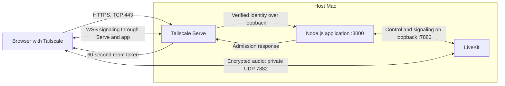

<div align="center">

# 🌷 Pink Party

**Good games. Better company.**

A cosy voice room for game nights, with a private network behind the pink.

TypeScript · Node.js · LiveKit · Tailscale · Playwright

[How it works](#how-it-works) · [Verified results](#verified-results) · [Run locally](#run-locally) · [Technical notes](#technical-notes)


</div>

## A little room for your people

Pink Party combines a fictional game-night card with one voice room for up to four connected participants. Pick a display name, join, mute your microphone when needed, and see who is in the room. The interface handles leaving, reconnecting and microphone cleanup.

The project is also a practical networking and operations lab: a working application makes it possible to inspect access boundaries, distinguish signaling from audio traffic, and test what happens when permissions or connections fail.

It runs natively on macOS. Local mode accepts connections only from the host machine. Private mode uses Tailscale, HTTPS and an explicit invited-account allowlist. There is no public demo endpoint; the screenshots and validation records can be reviewed without access to the private service.

## Technical work you can inspect

| Area                             | Implemented behavior                                                                                                                    | Evidence in the repository                                                                                                                                    |
| -------------------------------- | --------------------------------------------------------------------------------------------------------------------------------------- | ------------------------------------------------------------------------------------------------------------------------------------------------------------- |
| Network isolation                | Loopback-only application and LiveKit control listeners; private media restricted to the configured Tailscale IPv4 on UDP 7882.         | [Configuration](server/config.ts), [startup checks](scripts/start.ts) and [socket/ICE results](docs/validation-batch-3.md#https-identity-and-media-evidence). |
| Identity and access control      | Verified Serve identity plus an exact application allowlist; scoped tailnet rules for TCP 443 and UDP 7882.                             | [Request boundary](server/access.ts), [synthetic policy example](docs/tailnet-policy.example.json) and [private operations](docs/remote-access.md).           |
| Token permissions                | Server-signed, 60-second tokens for one room, microphone publishing and subscription. LiveKit enforces the four-person cap.             | [Admission logic](server/admission.ts) and [permission/capacity tests](tests/admission.test.ts).                                                              |
| Service operation                | Configuration validation, readiness checks, coordinated startup/shutdown and diagnostics. A failed backend service stops its companion. | [Supervisor](scripts/start.ts), [diagnostics](scripts/diagnose.ts) and [startup regression test](tests/startup.test.ts).                                      |
| Troubleshooting and verification | Separate checks for HTTP health, TLS, WebSocket upgrade, selected ICE candidates and decoded audio.                                     | [Real Serve test](tests/tailnet-browser/serve.spec.ts) and [dated validation](docs/validation-batch-3.md).                                                    |
| Client lifecycle                 | Permission errors, cancelled joins, mute state, reconnection and release of microphone tracks/audio elements.                           | [Voice controller](src/voice.ts) and [browser recovery tests](tests/browser/recovery.spec.ts).                                                                |

These are implementation and validation claims. The [contribution record](docs/learning.md) identifies the owner's confirmed actions and the work performed with assistance.

## How it works

The browser loads the private page through Tailscale Serve. Serve handles HTTPS and supplies the verified account identity; the application checks that identity against its own allowlist before serving pages, APIs or signaling.

When someone joins, the application checks admission and asks LiveKit to create or inspect the room. It returns a short-lived voice token. WebSocket signaling sets up the connection, while the audio takes a separate encrypted WebRTC path over private UDP.



| Traffic                                 | Local mode                               | Private mode                                                  |
| --------------------------------------- | ---------------------------------------- | ------------------------------------------------------------- |
| Page and admission API                  | `http://localhost:3000`, local join code | Exact HTTPS `*.ts.net` origin, verified invited identity      |
| Signaling                               | Loopback WebSocket on 7880               | Authenticated WSS `/livekit/rtc/v1` through Serve and the app |
| Voice media                             | Loopback UDP 7882                        | Configured Tailscale IPv4, UDP 7882                           |
| Application / LiveKit control listeners | `127.0.0.1:3000` / `127.0.0.1:7880`      | Remain on loopback                                            |

### Decisions behind the setup

- **Two access checks:** tailnet membership alone does not admit a user. Network policy restricts the destination ports, and the application checks the exact login. Additive allow-all rules must be removed or scoped appropriately.
- **A small trust boundary:** remote clients cannot directly reach the loopback backend. Serve replaces caller-supplied identity headers. Programs already running on the host remain trusted and can forge local headers.
- **Restricted tokens:** signing secrets stay on the server. Tokens grant no video, screen sharing, data publishing or room administration. Their 60-second expiry limits initial admission; it does not end an established call.
- **Separate evidence for each layer:** a healthy API or successful HTTPS request does not prove that audio is arriving. The media tests inspect selected ICE candidates, received bytes, decoded samples and audio energy.

Private mode has no development-code fallback. Funnel, router forwarding, external STUN discovery, LiveKit TCP media and TURN are excluded from this setup. Real credentials, identities and generated configuration stay in ignored private files; committed configuration examples are synthetic.

## Verified results

Recorded on **16 November 2026**, using native macOS services. Detailed environments, resource samples and test limits are in the [validation report](docs/validation-batch-3.md).

| Check                           | Result and scope                                                                                                                                          |
| ------------------------------- | --------------------------------------------------------------------------------------------------------------------------------------------------------- |
| Static checks and offline tests | TypeScript, production build, formatting and **14 offline tests passed**.                                                                                 |
| Local browser tests             | **13 passed**, including two/four synthetic clients, capacity enforcement, mute, reconnection and cleanup against real LiveKit.                           |
| Synthetic private proxy tests   | **Two passed** with fixture TLS/identity and real loopback media. These are explicitly separate from Tailscale verification.                              |
| Real Tailscale Serve            | Trusted certificate, secure context, identity replacement, WSS **101**, exact private UDP ICE candidates and decoded synthetic audio passed on one Mac.   |
| Human listening                 | The owner confirmed speech through two Chrome tabs, swapped mute directions, mute/unmute silence and recovery, and leave/rejoin with participant updates. |
| Resource sampling               | Application, LiveKit, Tailscale app, network extension and Serve CLI measured separately, with exclusions documented.                                     |

**Still to verify:** a call between physical devices in separate homes, real uninvited/tagged-peer boundaries, peer direct/relay routing and recovery after a physical client's network interruption. Same-Mac tabs do not establish those results.

Chrome is the verified browser for physical listening. Safari/WebKit reached signaling but failed to establish media during the recorded checks; its root cause remains unresolved. Linux deployment, monitoring exercises, tested backup recovery and cloud deployment are future work.

## Run locally

Use an ARM64 Mac with **Node.js 24** and native **LiveKit Server**. Tested patch versions and detailed configuration are recorded in the [local development guide](docs/local-development.md).

```sh
brew install node@24 livekit
export PATH="$(brew --prefix node@24)/bin:$PATH"
git clone https://github.com/V1cksy/pink-party.git
cd pink-party
npm ci
npm run setup
npm run build
npm start
```

Open **http://localhost:3000** in Chrome. Enter a display name and the `JOIN_CODE` from your generated `.env`, then allow the microphone. Do not share that file or include its contents in screenshots. Headphones help prevent feedback when testing two clients on one machine.

Press **Ctrl+C** to stop both backend services. Pink Party does not install a background service.

### Private mode

Complete the [Tailscale setup, policy review and HTTPS consent](docs/remote-access.md) first. That guide includes the synthetic configuration, adding actual invited logins, troubleshooting and rollback. Stop local mode before starting private mode.

```sh
# Terminal 1: application and LiveKit
npm run start:private

# Terminal 2: private HTTPS proxy
npm run serve:private
```

Open the HTTPS address printed by Serve. Stop both terminals with **Ctrl+C**. Never enable optional Funnel on the HTTPS consent page for this setup.

## Reproduce the checks

| Command                                         | Prerequisite / purpose                                                                                                                |
| ----------------------------------------------- | ------------------------------------------------------------------------------------------------------------------------------------- |
| `npm run check`                                 | Offline tests, TypeScript, build and formatting; no running services needed.                                                          |
| `npm run test:e2e`                              | Running **local mode**, installed Playwright Chromium and an empty room.                                                              |
| `npm run test:private`                          | The same local-mode prerequisites; starts the synthetic TLS/identity test proxy.                                                      |
| `npm run test:tailnet`                          | Running **private mode and real Serve**, an invited host identity, Chromium and an empty room. Uses synthetic microphones on one Mac. |
| `npm run diagnose` / `npm run diagnose:private` | Inspect the corresponding running mode; health alone is not a media test.                                                             |
| `npm run measure:private -- 10`                 | Sample running service processes and native Tailscale components. Record participant count and conditions separately.                 |

Install the test browser with `npx playwright install chromium`. Browser suites join the room; run them sequentially with no other participants. Raw private evidence and failed-test artifacts stay ignored. The [operations guide](docs/remote-access.md#repeat-the-real-serve-check) explains their handling.

## Technical notes

- [Local development and operations](docs/local-development.md): environment, configuration, development server, troubleshooting and teardown.
- [Private network operations](docs/remote-access.md): access rules, network paths, startup, shutdown and rollback.
- [Current validation](docs/validation-batch-3.md): actual results, resource measurements and outstanding checks.
- [Contribution and learning record](docs/learning.md): confirmed owner practice, code walkthrough and interview questions.
- [Earlier validation](docs/validation.md): initial local implementation; [private-access implementation tests](docs/validation-batch-2.md).

## Contributions and dependencies

The owner selected the gaming-hangout scope and pink design, completed native Tailscale onboarding and HTTPS consent, and performed the confirmed Chrome listening checks. Codex generated the application, configuration, tests and documentation and carried out the recorded technical verification with a separate review. LiveKit and its SDKs provide the voice transport.

The project records assisted implementation and personally confirmed practice separately. See the [learning record](docs/learning.md) for the current contribution details.

<div align="center">

🌸 Bring your game. Save a seat.

</div>
