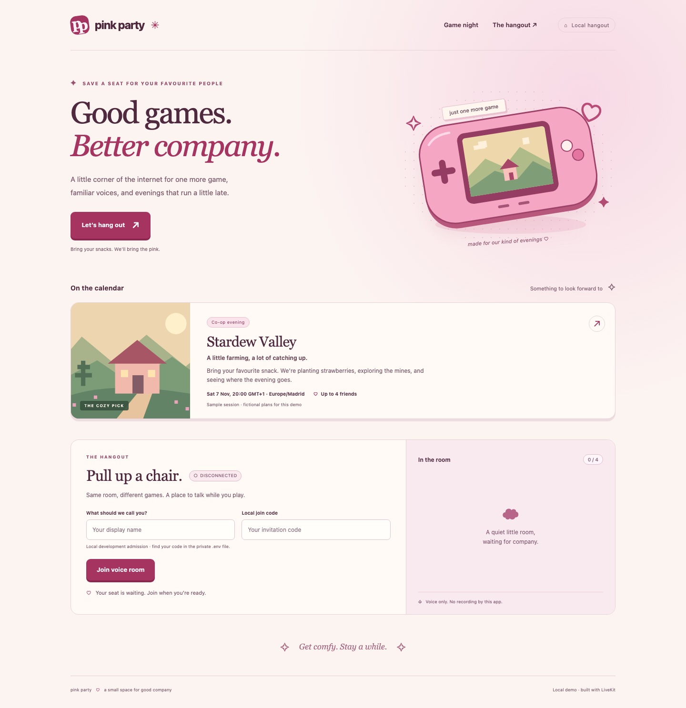
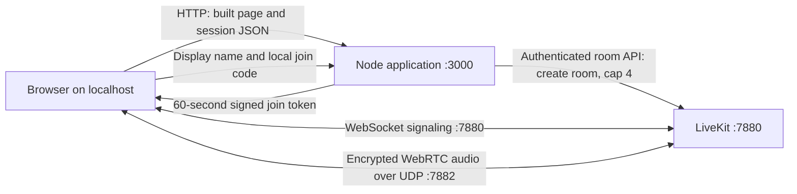

# Pink Party

A small, pink gaming hangout: check the next session, take a seat in one voice room, and talk while playing. The session is fictional demo data. The room supports up to four connected participants.



Batch 1 runs natively on a Mac and accepts connections from that machine only. LiveKit provides voice transport; this project implements the interface, admission checks, SDK integration, configuration and startup scripts. See [validation](docs/validation.md) for measured results and limits, and [learning notes](docs/learning.md) for contribution records and a code walkthrough.

## Requirements and setup

Tested on an ARM64 Mac with 8 GiB RAM, Node.js 24.22.2 LTS, npm 11.19.1 and LiveKit Server 1.13.11. Use Node 24; `.node-version` and `.nvmrc` record the tested patch. The npm dependencies are pinned in `package.json` and `package-lock.json`. No container or VM is required.

```sh
brew install node@24 livekit
export PATH="$(brew --prefix node@24)/bin:$PATH"
git clone https://github.com/V1cksy/pink-party.git
cd pink-party
npm ci
npm run setup
npm run build
npm start
```

Open **http://localhost:3000**. Enter a display name and the `JOIN_CODE` from `.env`, then allow microphone access. Use headphones when testing multiple clients to prevent feedback. `.env` can be opened in your editor; avoid sharing it or displaying it in screenshots.

`npm start` validates configuration and session data, writes a private LiveKit configuration, starts LiveKit, waits for its authenticated API, and starts the application. It stops both services when either exits. Press **Ctrl+C** in that terminal to stop both. It does not install a background service.

## Configuration

`npm run setup` generates random local credentials in `.env` with owner-only permissions. Running it again preserves an existing file. `.env.example` shows the variable names and placeholders. No `VITE_` secret variables are used.

| Variable             | Purpose                                                       |
| -------------------- | ------------------------------------------------------------- |
| `JOIN_CODE`          | Local development admission code, 16–128 URL-safe characters. |
| `LIVEKIT_API_KEY`    | Server API key, at least 12 URL-safe characters.              |
| `LIVEKIT_API_SECRET` | Server signing secret, at least 32 URL-safe characters.       |

The application and startup supervisor read `.env`. The browser receives only its short-lived voice token. Generated `.local/livekit.yaml` contains the API credentials and is ignored by Git, as is `.env`. To rotate all local credentials, stop the app, remove `.env`, run `npm run setup`, then restart. Existing tokens are bearer credentials and should not be shared.

Edit `data/session.json` to change the sample session, then restart. Use an ISO timestamp with an explicit offset, a valid IANA timezone such as `Europe/Madrid`, and `synthetic: true`. The UI displays the timezone and UTC offset explicitly.

## How it connects



All listeners bind to `127.0.0.1`. TCP media and TURN are disabled; UDP media is filtered to the loopback address. No router changes, public exposure, external STUN server or cloud service is needed. The web page and microphone secure context use `localhost`.

`POST /api/voice-token` checks the request host and origin, JSON size/type, display name and join code. It limits join attempts to 60 per minute across this local app and eight concurrent admission requests. The server creates the room with a four-person maximum and checks its current occupancy. LiveKit enforces the final cap, including competing connections with already issued tokens.

Tokens allow joining only `pink-party`, publishing microphone audio, and subscribing. They do not grant video, screen sharing, data publishing or room administration. The 60-second expiry limits initial admission; it does **not** end an established call. LiveKit can refresh tokens during a connection. The join code is a simple local development admission mechanism. Future remote access needs a separate identity and access design.

`GET /api/session` returns the sample data. `GET /api/health` returns 200 when the application can authenticate to LiveKit, or 503 when voice is unavailable. It does not prove microphone or media connectivity.

## Development and checks

Keep `npm start` running. In a second terminal, `npm run dev` serves the interface at **http://127.0.0.1:5173**, forwarding API requests to port 3000. For the normal built interface, run `npm run build` after changes and refresh port 3000.

```sh
npm run check
npx playwright install chromium
npm run test:e2e
npm run measure -- 10
```

`check` runs strict TypeScript checks, the offline Node test suite, the production build and Prettier checks. `npm run format` applies formatting. No separate linter is configured.

The browser suite needs the running app and LiveKit, `.env`, an empty voice room, and local browser installation. Close other Pink Party tabs before running it. It generates a synthetic 440 Hz WAV file, uses isolated Chromium clients and tests real LiveKit media reception. Device-denial and autoplay cases are deliberately injected in the browser; they are not tests of macOS permission dialogs. Test artifacts stay in ignored `.local/` and `test-results/`. Traces and screenshots on failure are disabled to avoid capturing credentials. Explicit UI screenshots contain no entered join codes.

`measure` is a macOS sampling script for the two listening service processes. Run it while the intended number of clients is connected. It reports RSS and the OS `ps` CPU estimate; it excludes browser and supervisor costs. See the recorded test conditions in [validation](docs/validation.md).

## Troubleshooting

| Symptom                                     | Action                                                                                                                          |
| ------------------------------------------- | ------------------------------------------------------------------------------------------------------------------------------- |
| `node`, `npm` or `livekit-server` not found | Install the requirements and run the PATH export above in this terminal.                                                        |
| Missing/invalid secrets                     | Run `npm run setup`; if `.env` already exists, check its values against `.env.example`.                                         |
| Port in use                                 | Stop the earlier Pink Party terminal or the other process using 3000, 7880 or UDP 7882; retry.                                  |
| Page missing or old interface               | Run `npm run build`, then refresh.                                                                                              |
| Join code rejected                          | Read the current `.env` in an editor. Codes are exact and are never logged by the app.                                          |
| Room full                                   | Wait for someone to leave. After an abrupt browser crash, LiveKit may need time to remove the lost participant.                 |
| Microphone denied                           | Allow microphone access for localhost in browser site settings and macOS Privacy & Security; join again.                        |
| Microphone unavailable                      | Connect an input device, check system input settings, close apps holding it, then join again.                                   |
| Connected but silent                        | Check actual mute labels, input/output devices and volume. If shown, click **Enable sound** and allow site audio.               |
| Reconnecting/disconnected                   | Check `/api/health` and the terminal. Wait for reconnection, or leave and join again. Restart `npm start` if a service stopped. |
| Tests cannot find the browser               | Run `npx playwright install chromium`.                                                                                          |

Permission prompts can remain open until you answer them; **Cancel join** leaves the interface usable. If permission is granted after cancellation, the late microphone track is stopped. Leaving or failing a join stops local tracks, disconnects the room and removes attached audio elements. The participant list and mute labels come from LiveKit state.

## Teardown and next work

Stop both `npm start` and any Vite terminal with Ctrl+C. To remove generated files from this checkout:

```sh
rm -rf node_modules dist .local test-results playwright-report
rm -f .env
```

These paths contain dependencies, builds, test artifacts and local credentials. Keep `.env` privately if you want to preserve the same code and keys. Browser downloads can be removed separately with `npx playwright uninstall chromium`. The project installs no login item or persistent service; Homebrew packages remain available for other projects.

Later batches: private HTTPS access from separate homes, remote identity, Linux deployment, monitoring and incident exercises, tested backup restoration, then a cloud extension. These operations have not been completed in this batch.

## Primary references

- [Node.js LTS releases](https://nodejs.org/en/about/previous-releases) and [Vite requirements](https://vite.dev/guide/)
- [Native LiveKit setup](https://docs.livekit.io/transport/self-hosting/local/) and [Homebrew formula](https://formulae.brew.sh/formula/livekit)
- [LiveKit configuration](https://github.com/livekit/livekit/blob/master/config-sample.yaml), [tokens and grants](https://docs.livekit.io/frontends/reference/tokens-grants/), [microphone publishing](https://docs.livekit.io/transport/media/publish/) and [track subscription](https://docs.livekit.io/transport/media/subscribe/)
- [LiveKit browser SDK](https://github.com/livekit/client-sdk-js) and [server SDK](https://github.com/livekit/server-sdk-js)
