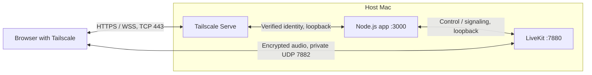

# Pink Party

A private voice room for up to four people to talk while they play. Pick a name, join the call, and see who’s speaking. The sample Stardew Valley plan is fictional; the voice room uses real LiveKit audio.


Built with TypeScript, Vite, Node.js 24 and LiveKit. Runs natively on macOS, with a loopback local mode and a private Tailscale mode, and as a local systemd deployment in an ARM64 Ubuntu VM. There is no public demo.

## Why this project

The voice room is also a networking lab. Its tests follow a connection from HTTPS admission through WebSocket signaling to WebRTC audio, including failed joins and interrupted connections. The code and validation records make each part available to inspect.

The [Linux deployment](docs/linux-deployment.md) adds a dedicated service account, root-owned application files, restricted writable state and automatic startup. Practical checks exercise backend crashes, invalid configuration, journal diagnosis and recovery. The [Linux validation record](docs/validation-linux.md) links the configuration and actual results.

The implementation includes:

- Loopback application and LiveKit control listeners. In private mode, media binds only to the configured Tailscale IPv4 on UDP 7882. See [configuration](server/config.ts) and [startup checks](scripts/start.ts).
- A verified Serve identity and an exact application allowlist, alongside tailnet rules scoped to TCP 443 and UDP 7882. See the [access boundary](server/access.ts) and [example policy](docs/tailnet-policy.example.json).
- Server-signed tokens valid for 60 seconds, restricted to one room and microphone publishing/subscription. LiveKit enforces the four-person limit. Token expiry limits initial admission; it does not end an established call. See [admission logic](server/admission.ts) and [tests](tests/admission.test.ts).
- Permission recovery, join cancellation, mute state and reconnection. Leaving or failing a join releases microphone tracks and attached audio. See the [voice controller](src/voice.ts) and [browser tests](tests/browser/recovery.spec.ts).
- Coordinated startup and shutdown, configuration validation and diagnostics. A failed backend stops its companion. See the [supervisor](scripts/start.ts) and [startup regression test](tests/startup.test.ts).

## Connection paths

In private mode, Tailscale Serve terminates HTTPS and supplies the verified account identity. The application checks that identity before serving the page, API or signaling. Local programs on the host remain trusted and can forge local identity headers.



The application issues the voice token after checking admission. WSS carries signaling; encrypted WebRTC audio travels over a separate UDP path. A healthy API or successful WebSocket upgrade alone does not establish that audio is arriving.

Private mode has no join-code fallback. This setup excludes Funnel, router forwarding, external STUN discovery, LiveKit TCP media and TURN. Real identities, credentials and generated configuration stay in ignored private files. See [private operations](docs/remote-access.md) for the full access model and its limits.

## Run locally

Use an ARM64 Mac with Node.js 24 and native LiveKit Server. Exact tested versions and configuration are in [local development](docs/local-development.md).

```sh
brew install node@24 livekit
export PATH="$(brew --prefix node@24)/bin:$PATH"
git clone https://github.com/V1cksy/pink-party.git
cd pink-party
npm ci
npm run setup
npm run build
npm start
```

Open **http://localhost:3000** in Chrome. Enter a display name and the `JOIN_CODE` from your generated `.env`, then allow the microphone. Keep that file private. Use headphones when testing two clients on one Mac to avoid feedback.

Press **Ctrl+C** to stop both services. This Mac quick start runs in the foreground.

For private access, follow the [Tailscale setup guide](docs/remote-access.md), including policy review, invited accounts and HTTPS consent. Once configured, stop local mode, run `npm run start:private` in one terminal and `npm run serve:private` in another. Open the HTTPS address Serve prints. Stop both terminals with Ctrl+C. Leave optional Funnel disabled.

For the Linux lab, follow [VM setup and systemd operations](docs/linux-deployment.md). Its browser and voice checks run inside the VM, with shared Mac folders and application port forwarding disabled. The native Mac private setup remains separate.

## Checks and known limits

```sh
npm run check
npx playwright install chromium
npm run test:e2e
```

`check` runs TypeScript, offline tests, the production build and formatting. The browser suite needs running local services and an empty room; it uses synthetic microphones against native LiveKit. Run browser suites sequentially with other room clients closed.

Recorded on 16 November 2026: 14 offline tests, 13 local browser cases and two synthetic TLS/identity-proxy cases passed. Real Tailscale Serve checks passed for trusted TLS, identity replacement, WSS 101, exact private UDP ICE candidates and decoded synthetic audio on one Mac. The owner also confirmed speech, mute/unmute and leave/rejoin through two Chrome tabs. Environments, resource samples and scope are in the [validation report](docs/validation-batch-3.md).

A call between physical devices in separate homes remains unverified, as do real uninvited/tagged-peer boundaries, direct/relay routing and recovery after a physical client loses its network. Safari/WebKit reached signaling but failed to establish media; the cause is unresolved. Chrome is the browser verified for human listening.

Additional commands and prerequisites:

| Command                                         | Purpose                                                            |
| ----------------------------------------------- | ------------------------------------------------------------------ |
| `npm run test:private`                          | Synthetic TLS/identity proxy with local services.                  |
| `npm run test:tailnet`                          | Real Serve and private services; synthetic microphones on one Mac. |
| `npm run diagnose` / `npm run diagnose:private` | Check running services. Health does not prove media reception.     |
| `npm run measure:private -- 10`                 | Sample app, LiveKit and Tailscale components separately.           |

Raw private evidence and failed-test artifacts stay ignored. See the [operations guide](docs/remote-access.md#repeat-the-real-serve-check) for handling them. Monitoring exercises, tested backup recovery and cloud deployment remain future work.

## Project notes

- [Local development](docs/local-development.md): setup, environment, troubleshooting and teardown.
- [Private operations](docs/remote-access.md): access rules, network paths and rollback.
- [Validation](docs/validation-batch-3.md): results, measurements and outstanding checks. Earlier records cover the [local implementation](docs/validation.md) and [private-access tests](docs/validation-batch-2.md).
- [Interface design](docs/design.md): design choices, research sources and verification.
- [Learning record](docs/learning.md): confirmed owner practice and code walkthrough.
- [Linux deployment](docs/linux-deployment.md) and [validation](docs/validation-linux.md): systemd configuration, permissions, failure exercises and local VM audio checks.

## Contributions

The owner chose the gaming-hangout scope and pink design, completed Tailscale onboarding and HTTPS consent, and performed the confirmed Chrome listening checks. Codex generated the application, configuration, tests and documentation, and carried out the recorded technical verification and interface revision. The earlier technical work included a separate review. The [learning record](docs/learning.md) distinguishes assisted work from personally confirmed practice.

Codex also installed the Linux VM, implemented its deployment and service configuration, and ran the recorded Linux checks and practical exercises. Independent owner practice on Linux remains unconfirmed.

LiveKit and its SDKs provide voice transport. The interface uses self-hosted Nunito Sans under the [SIL Open Font License](public/fonts/OFL.txt). The farmhouse is an original SVG illustration; it does not use Stardew Valley game assets.
