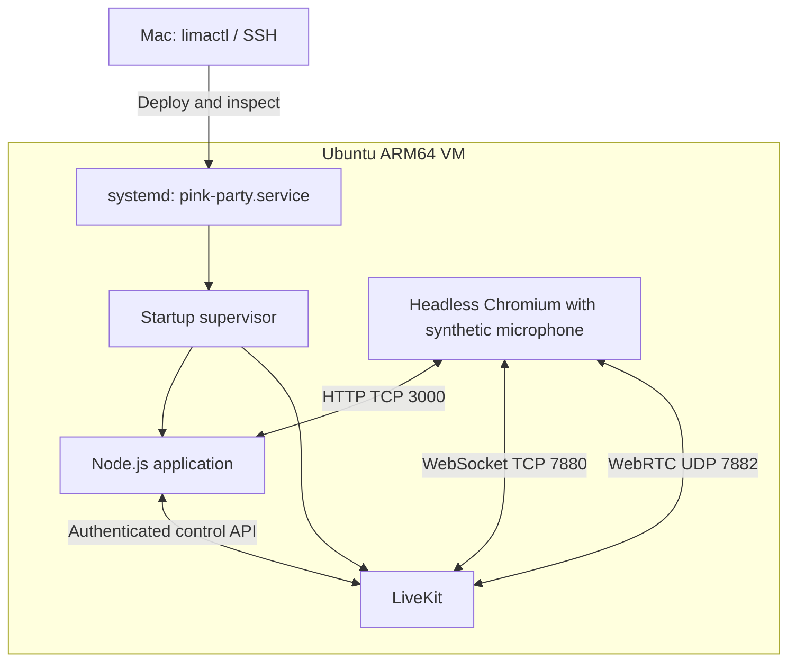

# Linux deployment

Pink Party runs as a systemd service in an ARM64 Ubuntu 24.04 VM. This lab covers service accounts, permissions, startup, logs and failure recovery. See the [actual results](validation-linux.md).

The Mac private-access setup remains separate. Linux uses local mode, with a browser inside the VM for synthetic voice tests. Tailscale is not installed in this guest; it is not a public server or cloud deployment.

## Environment and access

[Lima](https://lima-vm.io/docs/) uses macOS's Virtualization framework. The [VM configuration](../deploy/linux/lima.yaml) allocates two CPUs, 1536 MiB RAM and a 12 GiB sparse disk. It disables shared host folders, containerd and application port forwarding. Administrative SSH remains available through a localhost port on the Mac.

Application TCP 3000, LiveKit control/signaling TCP 7880 and voice UDP 7882 bind to guest loopback. The browser tests also run inside Linux; forwarding a web port alone would not carry this voice path to a Mac browser.



## Create and deploy

From the repository on an Apple Silicon Mac with Homebrew:

```sh
brew install lima
limactl start --name=pink-party --tty=false --timeout=10m deploy/linux/lima.yaml
bash deploy/linux/deploy.sh
```

The deployment script transfers the public files in [files.txt](../deploy/linux/files.txt). The shared [archive script](../deploy/linux/archive.sh) excludes `.env` and `.env.*` files at every level, `.local` and `node_modules`, then includes only the two public environment templates. The guest installer applies this same filter. Mac credentials stay on the Mac. Linux generates its own credentials on first installation and preserves them on subsequent deployments.

The [installer](../deploy/linux/install.sh) supports Ubuntu 24.04 ARM64. It verifies pinned SHA-256 hashes for Node.js 24.22.2 and LiveKit 1.13.11 before extraction, installs Ubuntu prerequisites and builds in a staging directory. A failed download or build leaves the existing application running. It then stops the service and switches the app and runtimes. Previous installed files are retained at `/opt/pink-party/previous`; the next deployment replaces that copy. Activation failures need inspection and, if necessary, rollback from this directory.

The dated Ubuntu image is checksum-pinned too. If the provider removes it, update the URL and digest together using the provider's checksums. There is no unchecked fallback download.

## Files and permissions

| Path                                             | Purpose and access                                                                                                       |
| ------------------------------------------------ | ------------------------------------------------------------------------------------------------------------------------ |
| `/opt/pink-party/app`                            | Root-owned code, dependencies and built interface; the service cannot modify them.                                       |
| `/opt/pink-party/node` and `/opt/pink-party/bin` | Root-owned Node.js and LiveKit runtimes.                                                                                 |
| `/etc/pink-party/pink-party.env`                 | Generated credentials, root-owned mode `0600` in a root-only directory. systemd reads them into the service environment. |
| `/var/lib/pink-party`                            | Service-owned mode `0700`; the app's `.local` symlink points here for generated LiveKit configuration.                   |
| `/etc/systemd/system/pink-party.service`         | Installed [service definition](../deploy/linux/pink-party.service).                                                      |
| `/var/lib/pink-party-monitor/history.json`       | Root-only monitor history, separate from application state; at most 2880 samples.                                        |

The service account has no login shell. The unit removes capabilities, prevents gaining privileges, hides home directories and makes the filesystem read-only apart from its state directory and private temporary storage. The service cgroup has a 512 MiB memory cap. LiveKit needs `AF_NETLINK` to enumerate interfaces; this socket family does not grant network-administration capabilities.

One unit runs the existing supervisor and its app/LiveKit children. If either backend exits, the supervisor stops its companion and exits; systemd restarts the group. Repeated failures are rate limited. An explicit stop does not trigger restart.

## Operate and inspect

Enter Linux from the Mac:

```sh
limactl shell --workdir=/tmp pink-party
```

Inside the guest:

```sh
sudo systemctl status pink-party.service --no-pager
sudo journalctl -u pink-party.service -n 50 --no-pager
sudo ss -ltnup
sudo /opt/pink-party/node/bin/node --env-file=/etc/pink-party/pink-party.env /opt/pink-party/app/scripts/diagnose.ts
sudo systemctl restart pink-party.service
sudo systemctl stop pink-party.service
sudo systemctl start pink-party.service
```

The service is enabled at guest boot. Lima starts manually; no Mac login item or host autostart service is installed. Stop the VM from the Mac to release memory:

```sh
limactl stop pink-party
limactl start pink-party
```

One final teardown left Lima's host agent waiting after shutdown. If this recurs, stop the application service, request guest poweroff with `limactl shell --workdir=/tmp pink-party sudo systemctl poweroff`, and inspect the current events in `~/.lima/pink-party/ha.stderr.log`. After the log confirms `[VZ] - vm state change: stopped`, `limactl stop --force pink-party` can clear the stale host agent and control files. This fallback was exercised after the guest had powered off.

To deploy changes, rerun `bash deploy/linux/deploy.sh` on the Mac. It uses the current working tree, including uncommitted public changes. Keep `/etc/pink-party` and `/var/lib/pink-party` when recovering an update. Credentials are not rotated by deployment.

## Scheduled monitoring

Deployment enables [pink-party-monitor.timer](../deploy/linux/pink-party-monitor.timer) at guest boot. It runs a separate [oneshot service](../deploy/linux/pink-party-monitor.service) 30 seconds after boot, then 30 seconds after each check finishes, with one-second scheduling accuracy. It has no `Requires`, `Wants`, `PartOf` or `BindsTo` relationship with the application. Stopping Pink Party leaves the timer running and does not cause an automatic application restart.

The [probe](../deploy/linux/service-health.ts) checks the application's active state, verifies that TCP 3000 and 7880 belong to its service cgroup, and requests `/api/health`. That endpoint calls LiveKit's authenticated control API. An `up` result establishes local web/control readiness; UDP reception, ICE, decoded audio and physical listening require their separate tests. Every sample explicitly says `media: not-tested`.

Commands have two-second timeouts and the HTTP request has a one-second timeout. The monitor unit has a 15-second execution timeout and a 96 MiB cgroup cap. It runs as root to inspect socket PIDs across service accounts, loads no credentials, and cannot access the application credential or state directories. It can write only its own state directory and private temporary storage under its filesystem restrictions.

[monitor.ts](../deploy/linux/monitor.ts) atomically replaces a root-only history file containing the newest 2880 samples, roughly a day at the normal cadence. It logs the initial state and changes of status/reason; repeated identical results remain in history. The [journal configuration](../deploy/linux/journald-monitor.conf) sets an 8 MiB size budget for persistent/runtime storage, 1 MiB files and seven-day retention. Journald removes archived files; active files can keep usage above the budget temporarily. These settings do not guarantee seven days of logs. Installation pauses monitoring while replacing code/runtime, then resumes it independently of application health. Failure cleanup also attempts to resume a paused timer and reports any failure.

Inside Linux:

```sh
sudo systemctl list-timers pink-party-monitor.timer --no-pager
sudo systemctl status pink-party-monitor.timer pink-party-monitor.service --no-pager
sudo journalctl --namespace=pink-party-monitor -u pink-party-monitor.service -n 30 --no-pager
sudo /opt/pink-party/node/bin/node --input-type=module -e 'import {readFileSync} from "node:fs"; console.log(JSON.parse(readFileSync("/var/lib/pink-party-monitor/history.json", "utf8")).slice(-5));'
```

The oneshot is normally `inactive (dead)` between checks. A recorded application outage exits successfully; monitor execution/storage errors fail the monitoring unit. Inspect `Result`, `ExecMainStatus`, timer activity and sample freshness to distinguish these cases. Corrupt history is retained for diagnosis and causes a visible monitor failure. After privately saving and inspecting it, move the history file aside and let the timer create a new one.

This is local recording without external notifications, automatic remediation or an outside watchdog. It cannot observe a powered-off VM, host failure or its own disabled timer. Stop it for planned maintenance with `sudo systemctl stop pink-party-monitor.timer pink-party-monitor.service`; resume with `sudo systemctl start pink-party-monitor.timer`. Both application and timer stay enabled for the next guest boot. No monitoring is expected while the VM is intentionally stopped.

## Repeat the scheduled incident exercise

Close room clients and run service exercises sequentially. This command deliberately interrupts the local lab:

```sh
sudo /opt/pink-party/node/bin/node --env-file=/etc/pink-party/pink-party.env /opt/pink-party/app/deploy/linux/incident.ts
```

The [runner](../deploy/linux/incident.ts) requires a healthy local deployment and enabled, active timer. It waits for a fresh scheduled baseline, timestamps `systemctl stop pink-party.service`, and waits up to 75 seconds for a scheduled down sample. It diagnoses the inactive unit, absent process/listeners and actual stop journal while confirming the timer remains active. It then starts the service, verifies owned health and waits for the first scheduled up sample after the start request. It never invokes the monitor to manufacture detection or recovery.

The runner shares the service verifier's lock and restores the normal service in cleanup. After interruption, inspect the service, timer and `/run/pink-party-verification.lock` before removing a stale lock. No credential or unit override is needed. A successful run writes `/var/lib/pink-party-monitor/incident.json`; raw service logs and any error details remain private in that directory. Publish only inspected summaries such as the [incident report](incident-linux-monitoring.md) and [validation data](validation-monitoring.json).

For manual diagnosis during an outage, use `systemctl show pink-party.service -p ActiveState -p SubState -p MainPID`, `journalctl -u pink-party.service`, and `ss -ltnup`. Compare those findings with the latest scheduled sample before choosing a recovery action. Measure from timestamps in the same guest; polling intervals and timer scheduling affect observed times.

The separate [installer regression exercise](../deploy/linux/test-monitor-install.sh) deliberately deploys a backend that exits after a successful interface build. Run it sequentially with the other service exercises:

```sh
sudo bash /opt/pink-party/app/deploy/linux/test-monitor-install.sh
```

It requires a healthy application and active timer, verifies failed activation is rejected while scheduled monitoring continues to record down, then redeploys the original source and checks health, timer activity and unchanged credentials. Its cleanup attempts restoration on failure. After interruption, inspect the root-only `/var/tmp/pink-party-monitor-install.*` workspace before deleting it; the `good` directory can be passed to its installer for recovery. The summary is `/var/lib/pink-party-monitor/install-validation.json`. This interrupts the lab and does not test backup restoration.

## Repeat the practical checks

With an empty room, inside the guest:

```sh
sudo /opt/pink-party/node/bin/node --env-file=/etc/pink-party/pink-party.env /opt/pink-party/app/deploy/linux/verify.ts
sudo bash /opt/pink-party/app/deploy/linux/test.sh
sudo bash /opt/pink-party/app/deploy/linux/test-install.sh
```

The verifier inspects users, capabilities, ownership and sockets, samples service memory, kills each backend separately, checks recovery and manual stop, and temporarily supplies invalid credentials. It checks the journal diagnostic without logging secrets, removes its override and restores normal service. These exercises interrupt the service. A lock prevents overlapping verifier runs. After an interrupted run, inspect its runtime files and override before removing a stale lock.

The report is `/var/lib/pink-party/linux-validation.json`. The browser runner installs Chromium and Ubuntu dependencies, then runs repository and browser checks from a separate root-only workspace. Raw media results, screenshots and the browser report are under `/var/tmp/pink-party-tests/.local`. Browser checks run outside the restricted service; their memory is not included in its cap.

The installer exercise forces a marked build failure and verifies that the existing service stays healthy with its original process. It then redeploys from a source tree containing synthetic private files, including a nested environment file. It checks their exclusion and verifies that existing credentials are unchanged. Its report is `/var/lib/pink-party/linux-install-validation.json`.

Keep raw logs and state private. Publish only inspected results such as [validation-linux.json](validation-linux.json). Synthetic audio proves local VM transport; physical listening and calls between homes need separate checks.

## References

- [Lima installation](https://lima-vm.io/docs/installation/), [VZ support](https://lima-vm.io/docs/config/vmtype/) and [disabling port forwarding](https://lima-vm.io/docs/config/port/#disabling-port-forwarding).
- [Ubuntu image checksums](https://cloud-images.ubuntu.com/releases/noble/release-20261017/SHA256SUMS), [Node.js checksums](https://nodejs.org/dist/v24.22.2/SHASUMS256.txt) and [LiveKit release](https://github.com/livekit/livekit/releases/tag/v1.13.11).
- [systemd sandbox directives](https://www.freedesktop.org/software/systemd/man/systemd.exec.html), [restart behavior](https://www.freedesktop.org/software/systemd/man/systemd.service.html) and [resource control](https://www.freedesktop.org/software/systemd/man/systemd.resource-control.html).
- [systemd timer scheduling](https://www.freedesktop.org/software/systemd/man/systemd.timer.html) and [journal storage limits](https://www.freedesktop.org/software/systemd/man/journald.conf.html).
