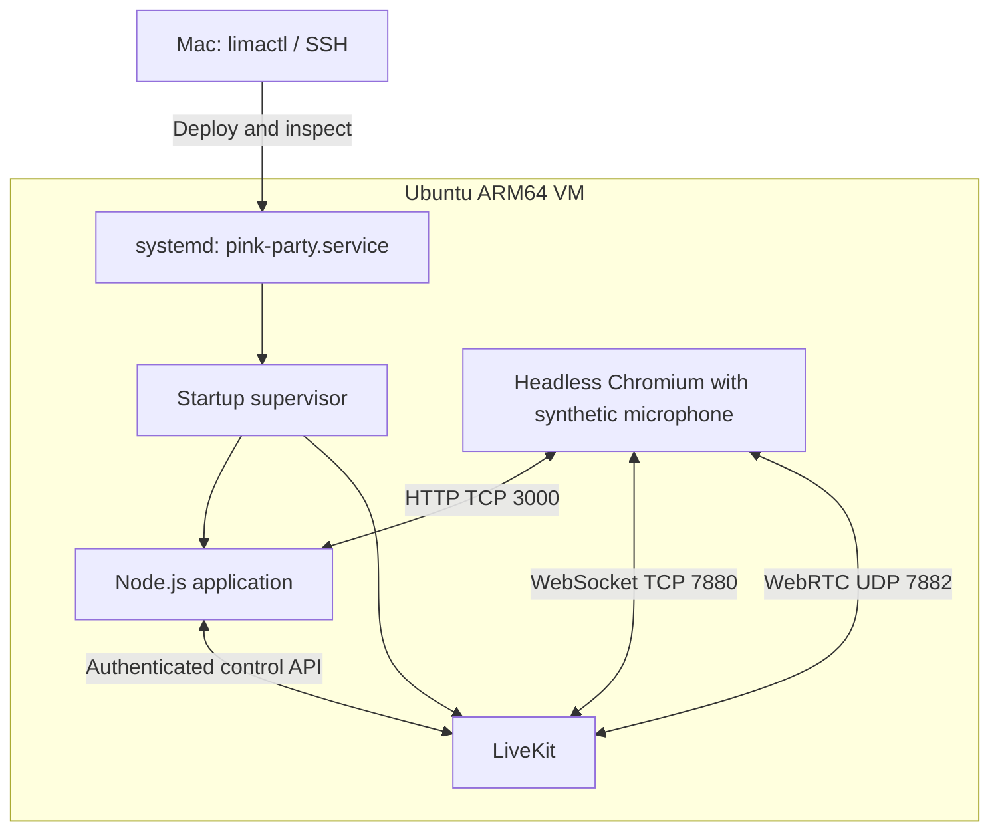

# Linux deployment

Pink Party runs as a systemd service in an ARM64 Ubuntu 24.04 VM. This lab covers service accounts, permissions, startup, logs and failure recovery. See the [actual results](validation-linux.md).

The Mac private-access setup remains separate. Linux uses local mode, with a browser inside the VM for synthetic voice tests. Tailscale is not installed in this guest; it is not a public server or cloud deployment.

## Environment and access

[Lima](https://lima-vm.io/docs/) uses macOS's Virtualization framework. The [VM configuration](../deploy/linux/lima.yaml) allocates two CPUs, 1536 MiB RAM and a 12 GiB sparse disk. It disables shared host folders, containerd and application port forwarding. Administrative SSH remains available through a localhost port on the Mac.

Application TCP 3000, LiveKit control/signaling TCP 7880 and voice UDP 7882 bind to guest loopback. The browser tests also run inside Linux; forwarding a web port alone would not carry this voice path to a Mac browser.



## Create and deploy

From the repository on an Apple Silicon Mac with Homebrew:

```sh
brew install lima
limactl start --name=pink-party --tty=false --timeout=10m deploy/linux/lima.yaml
bash deploy/linux/deploy.sh
```

The deployment script transfers the public files in [files.txt](../deploy/linux/files.txt). The shared [archive script](../deploy/linux/archive.sh) excludes `.env` and `.env.*` files at every level, `.local` and `node_modules`, then includes only the two public environment templates. The guest installer applies this same filter. Mac credentials stay on the Mac. Linux generates its own credentials on first installation and preserves them on subsequent deployments.

The [installer](../deploy/linux/install.sh) supports Ubuntu 24.04 ARM64. It verifies pinned SHA-256 hashes for Node.js 24.22.2 and LiveKit 1.13.11 before extraction, installs Ubuntu prerequisites and builds in a staging directory. A failed download or build leaves the existing application running. It then stops the service and switches the app and runtimes. Previous installed files are retained at `/opt/pink-party/previous`; the next deployment replaces that copy. Activation failures need inspection and, if necessary, rollback from this directory.

The dated Ubuntu image is checksum-pinned too. If the provider removes it, update the URL and digest together using the provider's checksums. There is no unchecked fallback download.

## Files and permissions

| Path                                             | Purpose and access                                                                                                       |
| ------------------------------------------------ | ------------------------------------------------------------------------------------------------------------------------ |
| `/opt/pink-party/app`                            | Root-owned code, dependencies and built interface; the service cannot modify them.                                       |
| `/opt/pink-party/node` and `/opt/pink-party/bin` | Root-owned Node.js and LiveKit runtimes.                                                                                 |
| `/etc/pink-party/pink-party.env`                 | Generated credentials, root-owned mode `0600` in a root-only directory. systemd reads them into the service environment. |
| `/var/lib/pink-party`                            | Service-owned mode `0700`; the app's `.local` symlink points here for generated LiveKit configuration.                   |
| `/etc/systemd/system/pink-party.service`         | Installed [service definition](../deploy/linux/pink-party.service).                                                      |

The service account has no login shell. The unit removes capabilities, prevents gaining privileges, hides home directories and makes the filesystem read-only apart from its state directory and private temporary storage. The service cgroup has a 512 MiB memory cap. LiveKit needs `AF_NETLINK` to enumerate interfaces; this socket family does not grant network-administration capabilities.

One unit runs the existing supervisor and its app/LiveKit children. If either backend exits, the supervisor stops its companion and exits; systemd restarts the group. Repeated failures are rate limited. An explicit stop does not trigger restart.

## Operate and inspect

Enter Linux from the Mac:

```sh
limactl shell --workdir=/tmp pink-party
```

Inside the guest:

```sh
sudo systemctl status pink-party.service --no-pager
sudo journalctl -u pink-party.service -n 50 --no-pager
sudo ss -ltnup
sudo /opt/pink-party/node/bin/node --env-file=/etc/pink-party/pink-party.env /opt/pink-party/app/scripts/diagnose.ts
sudo systemctl restart pink-party.service
sudo systemctl stop pink-party.service
sudo systemctl start pink-party.service
```

The service is enabled at guest boot. Lima starts manually; no Mac login item or host autostart service is installed. Stop the VM from the Mac to release memory:

```sh
limactl stop pink-party
limactl start pink-party
```

To deploy changes, rerun `bash deploy/linux/deploy.sh` on the Mac. It uses the current working tree, including uncommitted public changes. Keep `/etc/pink-party` and `/var/lib/pink-party` when recovering an update. Credentials are not rotated by deployment.

## Repeat the practical checks

With an empty room, inside the guest:

```sh
sudo /opt/pink-party/node/bin/node --env-file=/etc/pink-party/pink-party.env /opt/pink-party/app/deploy/linux/verify.ts
sudo bash /opt/pink-party/app/deploy/linux/test.sh
sudo bash /opt/pink-party/app/deploy/linux/test-install.sh
```

The verifier inspects users, capabilities, ownership and sockets, samples service memory, kills each backend separately, checks recovery and manual stop, and temporarily supplies invalid credentials. It checks the journal diagnostic without logging secrets, removes its override and restores normal service. These exercises interrupt the service. A lock prevents overlapping verifier runs. After an interrupted run, inspect its runtime files and override before removing a stale lock.

The report is `/var/lib/pink-party/linux-validation.json`. The browser runner installs Chromium and Ubuntu dependencies, then runs repository and browser checks from a separate root-only workspace. Raw media results, screenshots and the browser report are under `/var/tmp/pink-party-tests/.local`. Browser checks run outside the restricted service; their memory is not included in its cap.

The installer exercise forces a marked build failure and verifies that the existing service stays healthy with its original process. It then redeploys from a source tree containing synthetic private files, including a nested environment file. It checks their exclusion and verifies that existing credentials are unchanged. Its report is `/var/lib/pink-party/linux-install-validation.json`.

Keep raw logs and state private. Publish only inspected results such as [validation-linux.json](validation-linux.json). Synthetic audio proves local VM transport; physical listening and calls between homes need separate checks.

## References

- [Lima installation](https://lima-vm.io/docs/installation/), [VZ support](https://lima-vm.io/docs/config/vmtype/) and [disabling port forwarding](https://lima-vm.io/docs/config/port/#disabling-port-forwarding).
- [Ubuntu image checksums](https://cloud-images.ubuntu.com/releases/noble/release-20261017/SHA256SUMS), [Node.js checksums](https://nodejs.org/dist/v24.22.2/SHASUMS256.txt) and [LiveKit release](https://github.com/livekit/livekit/releases/tag/v1.13.11).
- [systemd sandbox directives](https://www.freedesktop.org/software/systemd/man/systemd.exec.html), [restart behavior](https://www.freedesktop.org/software/systemd/man/systemd.service.html) and [resource control](https://www.freedesktop.org/software/systemd/man/systemd.resource-control.html).
