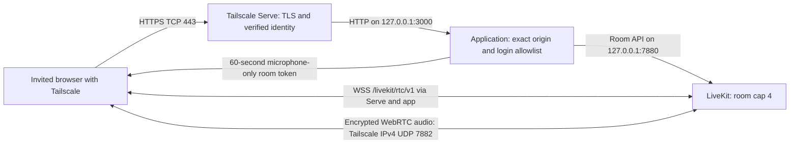

# Private access on macOS

This batch adds an invited-user mode for Tailscale and Tailscale Serve. Local mode remains the default. Native Tailscale setup and a call between separate homes are pending; see [batch 2 validation](validation-batch-2.md). No VM, public hosting, Funnel or router port forwarding is used.

## Install and configure

Use the [standalone macOS app](https://tailscale.com/docs/install/mac). The verified Homebrew cask on 4 November 2026 was `tailscale-app` 1.104.5. The native installer requires an administrator password; the owner must approve macOS network/VPN prompts and sign in. A GitHub CLI login does not sign in to Tailscale. The [Personal plan](https://tailscale.com/pricing) currently includes six users and three ACL groups at no charge. Choose that plan for this personal service.

```sh
brew install --cask tailscale-app
open -a Tailscale
```

Once signed in, use a terminal in this checkout:

```sh
export PATH="/opt/homebrew/opt/node@24/bin:/opt/homebrew/bin:$PATH"
export PATH="/Applications/Tailscale.app/Contents/MacOS:$PATH"
# The standalone app binary is named Tailscale; project scripts find it automatically.
Tailscale status
Tailscale serve status --json
npm run setup
npm run setup:private
```

`setup:private` discovers this device's DNS name, Tailscale IPv4 and untagged owner login from the connected client's status. It initially allows only that owner. It creates ignored `.local/invited-logins.txt` (one exact login per line) and `.env.private` ([synthetic variable reference](../.env.private.example)). To add a friend, obtain their actual Tailscale login, add it to that private text file, rerun setup, and restart private mode. Never copy identities, device addresses or `.env` files into issues or commits. The setup preserves an existing allowlist. It does not send invitations or edit the tailnet policy.

Scripts prefer the standalone app CLI, then `tailscale` on PATH. `PINK_PARTY_TAILSCALE_BIN` can select another native CLI location; it is also used to inject a fake executable in the startup regression test.

Only ASCII login names are supported by this version; non-ASCII identity-header encoding is rejected. Display names may contain Unicode. Clients must be signed in on untagged Tailscale devices because Serve does not populate user identity headers for tagged clients.

### Tailnet rules before inviting friends

Inspect and privately save the current policy in the [Tailscale admin console](https://login.tailscale.com/admin/acls) before changing it. Use [tailnet-policy.example.json](tailnet-policy.example.json) as a synthetic example, replacing the logins and host address privately. It permits the invited group to reach this Mac on TCP 443 and UDP 7882 only. The app separately checks its own allowlist. Keep both lists aligned.

Tailscale grants and ACLs are additive: an existing allow-all rule still permits access even if this narrower grant is added. Review rules that match this host and restrict those overlaps. Preserve unrelated access and services. Run the policy editor's tests, including the invited and uninvited examples, before saving. The example is intended for an isolated personal tailnet and is **not** a replacement for an uninspected existing policy. The example includes separate TCP and UDP assertions; passing them checks policy intent, while actual media delivery still needs a call. Do not grant friends access to ports 3000, 7880 or 7881.

Friends need Tailscale installed, signed in and connected. The owner adds them through Tailscale's normal user or device-sharing flow; this project sends no invitations. [Serve identity headers also support accepted device shares](https://tailscale.com/docs/features/tailscale-serve#identity-headers). Review the corresponding sharing access rules before using that alternative. Membership or a share by itself does not put a login on the application allowlist.

## Start, stop and switch modes

Build once after code changes with `npm run build`. Stop the previous mode first: both modes use the same app and signaling ports.

| Mode            | Start                                        | Address                                    | Stop                   |
| --------------- | -------------------------------------------- | ------------------------------------------ | ---------------------- |
| Local           | `npm start`                                  | `http://localhost:3000`; local `.env` code | Ctrl+C in its terminal |
| Private backend | `npm run start:private`                      | Loopback backend; open only through Serve  | Ctrl+C in its terminal |
| Private HTTPS   | `npm run serve:private` in a second terminal | HTTPS address printed by Serve             | Ctrl+C in its terminal |

`start:private` verifies that the connected Tailscale device matches the saved origin/address, and that the IPv4 address exists on a native interface. It fails before launching services if those checks fail. It generates `.local/livekit.yaml` with owner-only permissions. The app and LiveKit control/signaling API stay on loopback; only the media socket uses the exact Tailscale IPv4. No wildcard, LAN or external STUN candidate is configured. TCP media and TURN stay disabled. If the native client does not provide a bindable interface, stop and diagnose it; do not substitute a wildcard address.

`serve:private` inspects Serve status and saves a private timestamped snapshot before making changes. It refuses an existing 443 handler or active Funnel configuration and never resets other services. It runs **in the foreground**, so exiting removes its temporary handler. On first use, Serve may print a consent URL for enabling tailnet HTTPS certificates. Follow that URL and approve HTTPS; do not enable public Funnel. [Tailscale certificates](https://tailscale.com/docs/how-to/set-up-https-certificates) use the device's `*.ts.net` name; certificate transparency exposes that hostname, so choose a non-sensitive machine name.

Switch back by stopping the Serve and private backend terminals, then running `npm start`. Private mode cannot accept a development code. Local mode rejects proxy/identity headers, so an accidentally retained Serve handler cannot turn the code-based development service into remote admission. Generated settings are ignored by Git; restarting local mode rewrites the LiveKit file for loopback.

If the Serve terminal was lost, inspect `Tailscale serve status --json` against the saved `.local/serve-before-*.json`. Foreground handlers should disappear when their CLI session ends. Only if a Pink Party 443 handler remains and you have established that it belongs to this project, remove that handler with `Tailscale serve --https=443 off`. Do not use `serve reset`, `tailscale down`, or replace the entire policy to stop this app; those affect unrelated services. Restore policy changes from the privately saved policy if rolling back network access.

Removing someone from the app allowlist blocks new tokens and signaling connections after restart. It does not revoke an already established call or an issued bearer token immediately. For immediate removal, stop Serve and the backend (ending all calls), update both access lists, then restart. A 60-second token expiry limits initial admission, not call duration or LiveKit's refreshed reconnect credentials.

## Follow the network paths



The page reaches the Mac through Tailscale's private network. Serve terminates TLS, strips caller-supplied identity headers and supplies the verified login. The app checks that login against the private allowlist before serving pages, session data, admission or signaling. It also checks the exact configured Host and any Origin header. Admission POSTs and WebSocket upgrades require the page's origin. CSP allows only the configured WSS destination. The app forwards only the SDK's `/rtc`, `/rtc/v1` and their `/validate` routes; it does not expose LiveKit administration through that proxy.

The proxy boundary is the IPv4 loopback listener, consistent with [Serve's documented trust model](https://tailscale.com/docs/features/tailscale-serve#identity-headers). LAN and tailnet clients cannot connect directly to it. Requests using local-development hosts are rejected in private mode even with forged identity headers. Software already running on this Mac can forge the exact Host and identity headers; localhost is trusted, and these headers are not cryptographic proof outside that boundary. Keep the host trusted and do not expose or forward port 3000 through another proxy. A hostile local process also has access to this user's environment and secrets.

The app signs a token that permits only microphone publishing and subscription in `pink-party`, then LiveKit enforces the room cap. The browser's WSS connection carries control messages through the same authenticated proxy. Actual audio uses DTLS/SRTP on a separate UDP path inside Tailscale; HTTPS success cannot establish that it works. Tailscale may transport that private traffic directly or through its relay infrastructure. TCP media being disabled in LiveKit does not prevent Tailscale relaying its own packets.

## Diagnose one layer at a time

```sh
npm run diagnose           # local mode
npm run diagnose:private   # private mode
lsof -nP -iTCP:3000 -iTCP:7880 -iUDP:7882
Tailscale status
Tailscale serve status --json
Tailscale ping <friend-device-name>
```

Do not paste whole Tailscale status or generated configuration into a public report: it contains private identities and addresses. Diagnostics never print admission codes or bearer tokens. DevTools network URLs for LiveKit contain tokens; do not share screenshots of their query strings.

| Layer / symptom                        | Check and recovery                                                                                                                                                                                                                                                                                                      |
| -------------------------------------- | ----------------------------------------------------------------------------------------------------------------------------------------------------------------------------------------------------------------------------------------------------------------------------------------------------------------------- |
| Tailscale disconnected, DNS unresolved | Confirm both devices are connected and the current device still matches `.env.private`. Test the peer with `Tailscale ping`; direct versus relayed is useful evidence, but ping alone is not audio.                                                                                                                     |
| TLS/page unavailable                   | Use the exact HTTPS `*.ts.net` address from Serve. Check Serve status, its HTTPS consent, system clock and browser certificate. Do not bypass a real certificate warning.                                                                                                                                               |
| Identity 403                           | Check the actual signed-in login against the private allowlist and tailnet rules. No user identity is supplied for tagged client devices. A request from the host to its own Serve URL may lack a peer identity on some client paths; verify from a second tailnet device and keep rejection fail-closed.               |
| Health 503                             | The app is reachable but cannot authenticate to LiveKit. Inspect the backend terminal; restart the backend if needed. Health does not exercise ICE or sound.                                                                                                                                                            |
| Token request 403                      | Check exact page origin and identity. The local join code has no effect in private mode. A full room returns 409.                                                                                                                                                                                                       |
| WSS fails                              | Browser Network should show `/livekit/rtc/v1` (or legacy `/rtc`) upgrading with 101. Check the private backend, proxy terminal, CSP, exact Origin and invite. HTTP 200 or a token alone does not prove signaling.                                                                                                       |
| Connected but silent / ICE timeout     | Check UDP 7882 bound to the saved Tailscale IPv4, matching advertised ICE candidate, both Tailscale clients, and UDP access policy. Inspect browser WebRTC stats for selected candidate pair, increasing inbound audio bytes/samples/energy. Then check real input/output selection, permission, mute and Enable sound. |
| Stuck microphone after leave           | Verify the microphone indicator goes off and tracks stop. Refresh the page if it persists; record the browser and ordering.                                                                                                                                                                                             |
| Backend exits / Mac sleeps             | Keep the host awake for the test. The supervisor stops the other backend service if one exits. Restore Tailscale, restart the backend and verify health; clients may need to leave/rejoin.                                                                                                                              |

Expected listeners: Node TCP `127.0.0.1:3000`; LiveKit TCP `127.0.0.1:7880`; LiveKit UDP `<this Mac's Tailscale IPv4>:7882` in private mode, or `127.0.0.1:7882` locally. Serve owns private HTTPS 443 through Tailscale and might not appear as a conventional wildcard TCP listener. No port 7881, TURN or public router forwarding is required.

## Exact manual call test still needed

1. Complete native installation/sign-in and HTTPS consent, review the tailnet policy, then run private setup and the two private terminals. On a second physical device connected to Tailscale, open the printed HTTPS address. Confirm the certificate is valid, `window.isSecureContext` is true in DevTools, the private badge appears and no code field appears. An uninvited account must get 403; a supplied forged `Tailscale-User-Login` must not change that outcome.
2. With headphones and real microphones, have the owner and an invited friend join from **different homes/networks**. Each says a short phrase and repeats what the other said. Confirm intelligible speech in both directions; record browser/OS, devices, networks, participant count and whether Tailscale reports direct or relayed connectivity. Do not record or publish real addresses or identities.
3. Toggle mute on each device and confirm both the remote label and silence; unmute and hear speech again. Leave/rejoin and check participant updates. Briefly disconnect a test client's network, restore it, and confirm either usable reconnection or a successful fresh join with the old microphone released. Keep DevTools evidence limited to route/status and selected media protocol/counters, excluding token URLs.
4. Stop Serve and confirm remote access ends. Stop the backend and check that its sockets disappear. Restart and repeat a short exchange. Save only the checks the owner actually performed, including failures. A same-house device test is useful but does not replace the separate-home call.

Run `npm run check`, `npm run test:e2e`, and `npm run test:private` for automated verification. The last two need an empty, running **local-mode** LiveKit room. The private suite uses a synthetic HTTPS/identity proxy on loopback 3443 and ephemeral app port, with real LiveKit loopback media. Its browser trusts a test certificate only for that harness; it is not a Tailscale test and must never be used to host the service.

## Official references checked on 4 November 2026

- [Tailscale macOS installation](https://tailscale.com/docs/install/mac), [Personal limits](https://tailscale.com/pricing), [Serve](https://tailscale.com/docs/features/tailscale-serve) and [Serve CLI](https://tailscale.com/docs/reference/tailscale-cli/serve).
- [Tailscale grants](https://tailscale.com/docs/features/access-control/grants). Additive policy rules must be reviewed in the actual tailnet.
- [Serve v1.104.5 implementation](https://github.com/tailscale/tailscale/blob/v1.104.5/ipn/ipnlocal/serve.go): preserves the incoming HTTP Host for TCP-backed HTTP proxies, replaces identity headers, and uses Go's reverse proxy for HTTP/WebSocket forwarding.
- [LiveKit 1.13.11 configuration](https://github.com/livekit/livekit/blob/v1.13.11/config-sample.yaml): node address, UDP mux, IP filters and disabled external-IP discovery. Actual Tailscale socket/ICE behaviour remains to be checked after login.
